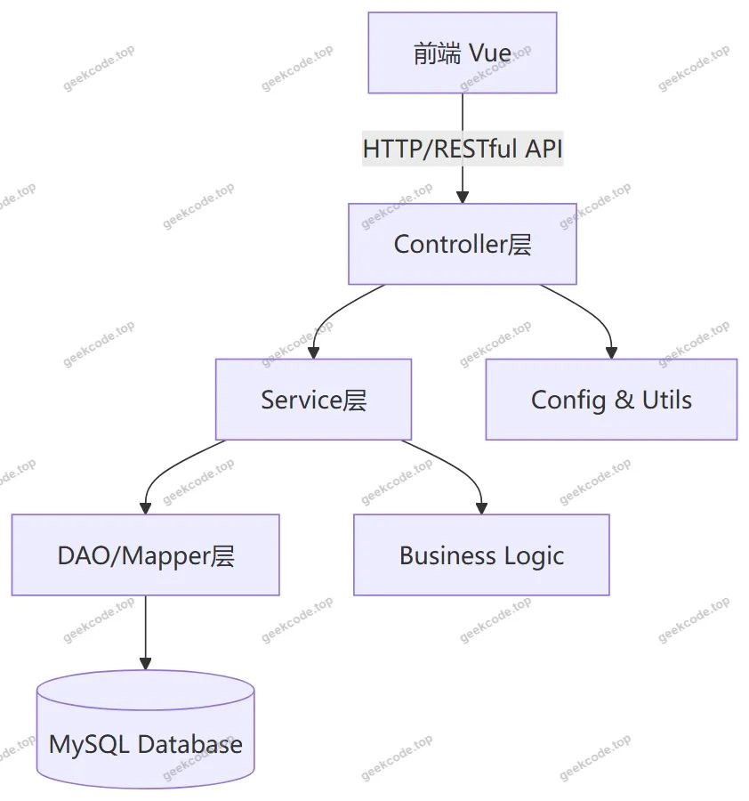
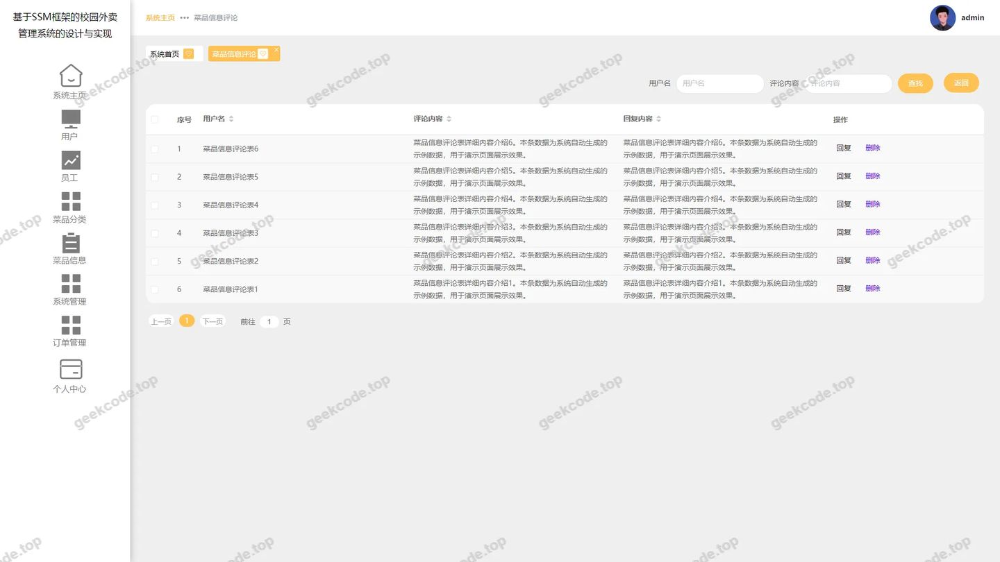
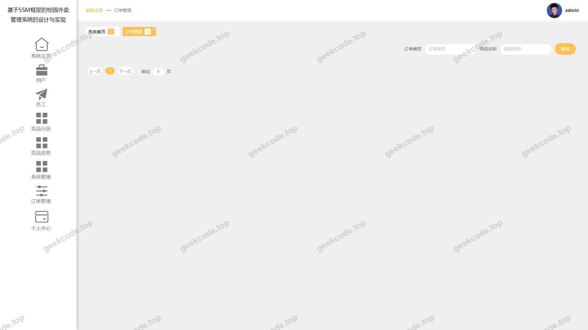
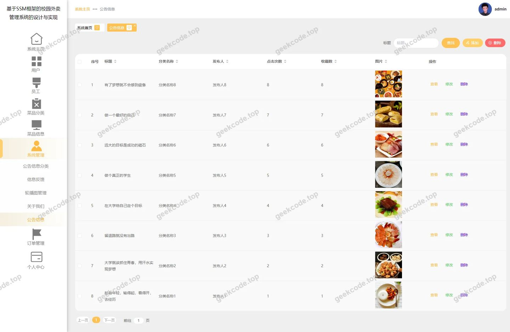
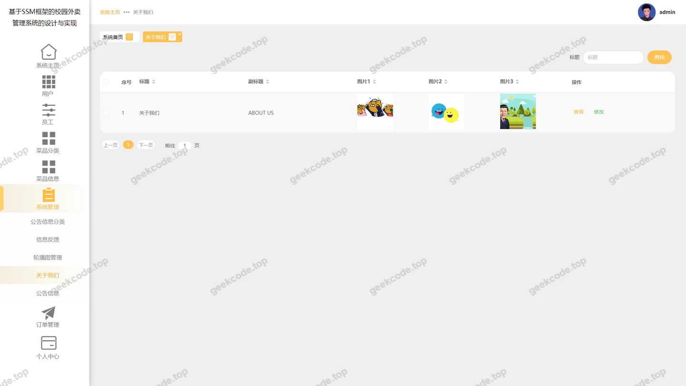
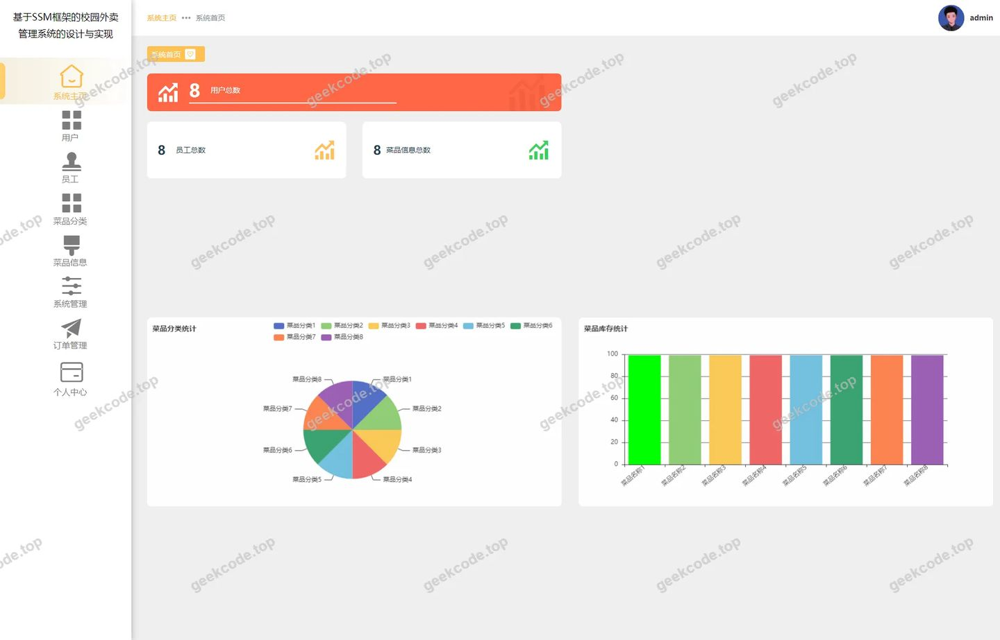
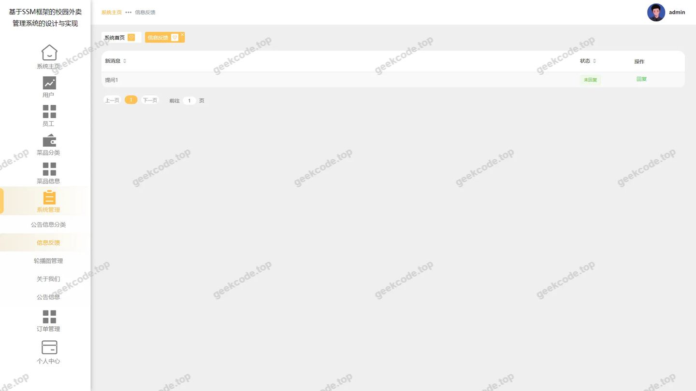
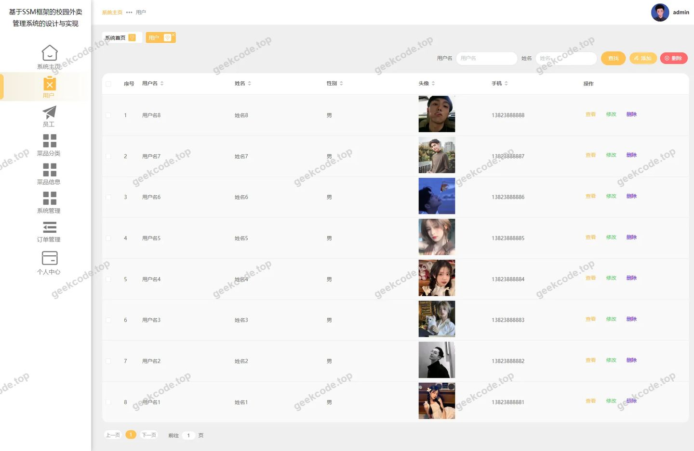
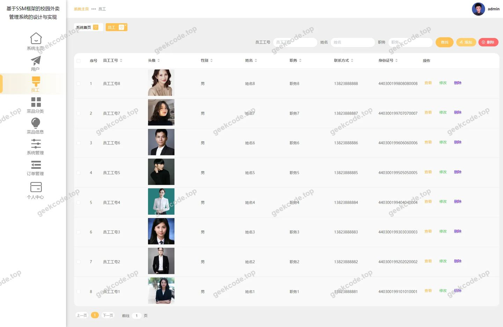

# 基于SSM框架的校园外卖管理系统的设计与实现

> 🎓 **计算机毕业设计 · 基于SSM框架的校园外卖管理系统的设计与实现**
>
> 本仓库只放**项目介绍 + 运行截图**（截图是站点带水印的原图，存在仓库 `images/` 里）。
>
> 👉 **完整可运行源码 / 数据库脚本 / 部署文档：[点我获取](https://geekcode.top/archives/%E5%9F%BA%E4%BA%8ESSM%E6%A1%86%E6%9E%B6%E7%9A%84%E6%A0%A1%E5%9B%AD%E5%A4%96%E5%8D%96%E7%AE%A1%E7%90%86%E7%B3%BB%E7%BB%9F%E7%9A%84%E8%AE%BE%E8%AE%A1%E4%B8%8E%E5%AE%9E%E7%8E%B0?utm_source=github)**
>
> 💬 咨询微信：**ir9372**　|　🌐 更多项目：[极客代码 geekcode.top](https://geekcode.top/?utm_source=github)
>
> 📌 项目详情页：<https://geekcode.top/archives/%E5%9F%BA%E4%BA%8ESSM%E6%A1%86%E6%9E%B6%E7%9A%84%E6%A0%A1%E5%9B%AD%E5%A4%96%E5%8D%96%E7%AE%A1%E7%90%86%E7%B3%BB%E7%BB%9F%E7%9A%84%E8%AE%BE%E8%AE%A1%E4%B8%8E%E5%AE%9E%E7%8E%B0?utm_source=github>

<table><td width="230" align="center"> <b>扫码加微信 ir9372</b></td><td valign="middle">📦 源码 = 项目介绍 + 全部运行截图 + 数据库 + 部署文档 👉 点上方任意截图，直接跳到 <b>极客代码 geekcode.top</b> 详情页</td></table>

---

<h1>基于SSM框架的校园外卖管理系统的设计与实现</h1>
<h2>项目概述</h2>

本项目旨在设计并实现一个基于SSM框架的校园外卖管理系统，以解决高校师生日常就餐效率低、食堂高峰期排队拥挤等痛点。系统采用前后端分离架构（Vue-Integrated模式），主要面向后台管理员进行数据维护与业务监控。核心功能涵盖菜品信息管理、订单全流程处理、用户与员工账户管理、公告发布及即时通讯反馈等模块。通过MyBatis-Plus简化数据持久层操作，结合Druid连接池提升数据库性能，实现了高效稳定的后端服务。该系统适用于高校后勤管理部门或第三方运营团队，用于规范化校园餐饮业务流程，提升服务响应速度与管理透明度。

<h2>技术架构</h2>
<h3>1. 整体架构</h3>

系统采用经典的三层架构设计，基于Spring Boot快速构建后端服务，前端采用Vue框架集成开发模式。后端负责业务逻辑处理、数据交互及安全控制，前端负责视图渲染与用户交互。

<h3>2. 核心技术选型</h3>
<ul>
<li><strong>后端框架</strong>：使用Spring Core, Spring Context, Spring Web MVC等组件构建应用上下文与Web服务；利用Spring TX实现事务管理，确保订单状态变更等关键操作的原子性。</li>
<li><strong>持久层框架</strong>：选用MyBatis-Plus作为ORM框架，其强大的代码生成器与通用CRUD接口大幅减少了样板代码，提高了开发效率。</li>
<li><strong>数据库连接池</strong>：集成Alibaba Druid，提供高效的数据库连接管理、SQL监控及防火墙功能，保障系统在并发访问下的稳定性。</li>
<li><strong>测试框架</strong>：引入JUnit进行单元测试，确保核心业务逻辑的正确性。</li>
</ul>
<h3>3. 数据库设计要点</h3>

根据控制器与路由信息推断，数据库主要包含以下实体表结构：

<ul>
<li><strong>基础信息类</strong>：<code>caipinxinxi</code>（菜品信息）、<code>caipinfenlei</code>（菜品分类）、<code>aboutus</code>（关于我们）。</li>
<li><strong>用户体系类</strong>：<code>yonghu</code>（普通用户/学生）、<code>yuangong</code>（员工/配送员）、<code>address</code>（收货地址）。</li>
<li><strong>业务交易类</strong>：<code>orders</code>（订单记录，含状态字段）、<code>cart</code>（购物车）。</li>
<li><strong>互动反馈类</strong>：<code>chat</code>/<code>chatmessage</code>（即时通讯消息）、<code>discusscaipinxinxi</code>（菜品评论）、<code>newstype</code>/<code>news</code>（公告资讯）、<code>config</code>（系统配置）。</li>
</ul>
<h2>功能模块</h2>

由于本项目无独立前台用户端界面，所有功能均通过后台管理端（Admin）进行集中管理与展示。以下是基于后台路由与截图整理的功能模块：

<h3>1. 系统首页与配置</h3>
<ul>
<li><strong>后台首页</strong>：展示系统概览、关键数据统计及快捷入口。</li>
<li><strong>系统配置 (/config)</strong>：管理网站基本信息、Logo、版权信息等全局参数。</li>
<li><strong>关于我们 (/aboutus)</strong>：编辑和维护平台介绍、联系方式等静态内容。</li>
</ul>
<h3>2. 用户与员工管理</h3>
<ul>
<li><strong>用户管理 (/yonghu)</strong>：对注册学生/教师账号进行增删改查，查看用户详细信息及历史行为。</li>
<li><strong>员工管理 (/yuangong)</strong>：维护配送员或内部工作人员档案，包括姓名、联系方式、职位等信息。</li>
<li><strong>注册管理 (/register/*)</strong>：处理新用户或新员工的注册申请审核与信息录入。</li>
</ul>
<h3>3. 餐饮业务管理</h3>
<ul>
<li><strong>菜品分类 (/caipinfenlei)</strong>：定义和管理外卖菜品的类别（如主食、饮品、小吃等）。</li>
<li><strong>菜品信息 (/caipinxinxi)</strong>：上架、下架菜品，设置价格、图片、库存及详细描述。</li>
<li><strong>菜品评论 (/discusscaipinxinxi)</strong>：查看用户对菜品的评分与文字评论，支持回复或删除违规评论。</li>
</ul>
<h3>4. 订单与物流管理</h3>
<ul>
<li><strong>订单管理 (/orders/:status)</strong>：根据状态（待支付、制作中、配送中、已完成、已取消）筛选和处理订单。支持订单详情查看、状态更新及异常处理。</li>
</ul>
<h3>5. 内容与互动管理</h3>
<ul>
<li><strong>公告信息 (/news)</strong>：发布校园餐饮通知、优惠活动或紧急停餐公告。</li>
<li><strong>新闻类型 (/newstype)</strong>：对公告进行分类管理（如官方通知、活动宣传等）。</li>
<li><strong>信息反馈 (/chat)</strong>：查看用户提交的咨询或投诉消息，并进行在线回复，实现双向沟通。</li>
</ul>
<h2>用户角色与权限</h2>

本系统主要服务于后台管理人员，根据现有路由和控制器分析，涉及的角色及其权限如下：

<h3>1. 超级管理员 (Admin)</h3>

拥有系统的最高权限，可访问所有后台路由模块。

<ul>
<li><strong>权限范围</strong>：</li>
<li><strong>全量数据管理</strong>：可对用户、员工、菜品、分类、订单、评论、公告等所有数据进行新增、修改、删除和查询操作。</li>
<li><strong>系统配置</strong>：修改网站基本配置及“关于我们”内容。</li>
<li><strong>订单处理</strong>：查看所有状态的订单，并可手动干预订单状态流转。</li>
<li><strong>互动回复</strong>：读取并回复用户通过聊天模块发送的信息。</li>
</ul>
<h3>2. 普通用户 (Yonghu) - <em>间接管理对象</em></h3>

虽然无独立前台界面，但用户数据在后台可见。

<ul>
<li><strong>数据属性</strong>：作为被管理对象，其产生的订单、评论、聊天记录在后台对应模块中呈现。</li>
<li><strong>权限限制</strong>：无法直接登录后台，其行为受限于前端应用（若存在未展示的C端App/H5）或通过API提交的数据。</li>
</ul>
<h3>3. 员工 (Yuangong) - <em>间接管理对象</em></h3>
<ul>
<li><strong>数据属性</strong>：作为配送或运营人员，其个人信息由管理员在 <code>/yuangong</code> 模块维护。</li>
<li><strong>权限限制</strong>：根据现有信息，未见独立的员工工作台路由，推测其工作指令可能通过订单状态变更或即时通讯传达。</li>
</ul>

<em>(注：根据现有源码上下文，未发现细粒度的RBAC角色区分配置，故默认所有访问后台 <code>/admin</code> 路径的用户具备上述超级管理员权限。)</em>

<h2>项目特色与创新点</h2>
<ol>
<li><strong>高效的数据持久化方案</strong>：引入MyBatis-Plus替代传统MyBatis，利用其内置的分页插件、乐观锁插件及条件构造器，显著提升了复杂查询（如多状态订单筛选、多维度菜品搜索）的开发效率与维护性。</li>
<li><strong>实时监控与安全防护</strong>：集成Druid连接池，不仅优化了数据库连接性能，还提供了SQL执行监控面板，帮助管理员及时发现慢查询和安全风险，保障校园高并发场景下的系统稳定性。</li>
<li><strong>闭环的业务流程设计</strong>：从“菜品上架 -&gt; 用户下单 -&gt; 订单状态流转 -&gt; 评价反馈 -&gt; 客服介入”，形成了完整的外卖业务闭环。特别是将“信息反馈(/chat)”与“订单管理”并列，强调了售后服务在校园餐饮中的重要性。</li>
<li><strong>模块化与解耦设计</strong>：控制器划分清晰（如 <code>AddressController</code>, <code>CartController</code> 独立存在），便于后续扩展如“地图定位配送”或“智能推荐算法”等功能，符合微服务演进思路。</li>
</ol>
<h2>部署环境</h2>

为确保系统正常运行，需准备以下软件环境：

<table>
<thead>
<tr>
<th align="left">组件</th>
<th align="left">版本要求/说明</th>
<th align="left">用途</th>
</tr>
</thead>
<tbody><tr>
<td align="left"><strong>JDK</strong></td>
<td align="left">Java 8 或 Java 11</td>
<td align="left">Spring Boot 运行基础环境</td>
</tr>
<tr>
<td align="left"><strong>Maven</strong></td>
<td align="left">3.6+</td>
<td align="left">项目依赖管理与构建工具</td>
</tr>
<tr>
<td align="left"><strong>MySQL</strong></td>
<td align="left">5.7 或 8.0</td>
<td align="left">关系型数据库存储引擎</td>
</tr>
<tr>
<td align="left"><strong>Node.js</strong></td>
<td align="left">LTS版本 (建议 v14+)</td>
<td align="left">前端Vue项目编译与打包环境</td>
</tr>
<tr>
<td align="left"><strong>IDE</strong></td>
<td align="left">IntelliJ IDEA / Eclipse</td>
<td align="left">后端代码开发与调试</td>
</tr>
<tr>
<td align="left"><strong>浏览器</strong></td>
<td align="left">Chrome / Edge</td>
<td align="left">后台管理系统访问终端</td>
</tr>
</tbody></table>

<strong>部署步骤简述：</strong>

<ol>
<li>初始化MySQL数据库，导入项目提供的SQL脚本创建表结构。</li>
<li>修改后端 <code>application.yml</code> 配置文件，填入正确的数据库URL、用户名和密码。</li>
<li>使用Maven命令 <code>mvn clean package</code> 打包后端Jar包。</li>
<li>进入前端目录，执行 <code>npm install</code> 安装依赖，随后执行 <code>npm run build</code> 生成静态资源文件。</li>
<li>启动后端Jar包，并将前端生成的 <code>dist</code> 文件夹部署至Nginx或直接放入Spring Boot的静态资源目录下统一启动。</li>
</ol>
<h2>五、技术特性</h2>
<ul>
<li>前后端集成部署，前端资源打包至后端 static 目录</li>
<li>使用 MyBatis-Plus 简化数据访问层开发</li>
</ul>
<h2>六、功能模块截图</h2>
<h3>后台管理端</h3>
<h4>后台-菜品信息评论</h4>

<h4>后台-登录页</h4>

<h4>后台-订单管理</h4>

<h4>后台-公告信息</h4>

<h4>后台-关于我们</h4>

<h4>后台首页</h4>

<h4>后台-信息反馈</h4>

<h4>后台-用户</h4>

<h4>后台-员工</h4>

---

## 获取完整源码

| 项目 | 说明 |
| --- | --- |
| 项目名 | 基于SSM框架的校园外卖管理系统的设计与实现 |
| 运行截图 | 本文 10 张（站点带水印原图，仓库 `images/` 目录） |
| 完整源码 | [https://geekcode.top/archives/%E5%9F%BA%E4%BA%8ESSM%E6%A1%86%E6%9E%B6%E7%9A%84%E6%A0%A1%E5%9B%AD%E5%A4%96%E5%8D%96%E7%AE%A1%E7%90%86%E7%B3%BB%E7%BB%9F%E7%9A%84%E8%AE%BE%E8%AE%A1%E4%B8%8E%E5%AE%9E%E7%8E%B0?utm_source=github](https://geekcode.top/archives/%E5%9F%BA%E4%BA%8ESSM%E6%A1%86%E6%9E%B6%E7%9A%84%E6%A0%A1%E5%9B%AD%E5%A4%96%E5%8D%96%E7%AE%A1%E7%90%86%E7%B3%BB%E7%BB%9F%E7%9A%84%E8%AE%BE%E8%AE%A1%E4%B8%8E%E5%AE%9E%E7%8E%B0?utm_source=github) |
| 咨询微信 | **ir9372**（备注：jingpin-yuanma） |
| 更多项目 | [极客代码 geekcode.top](https://geekcode.top/?utm_source=github) |

> 需要源码、部署、改配置、跑不起来等问题，加微信 ir9372 沟通，说明项目名即可。
